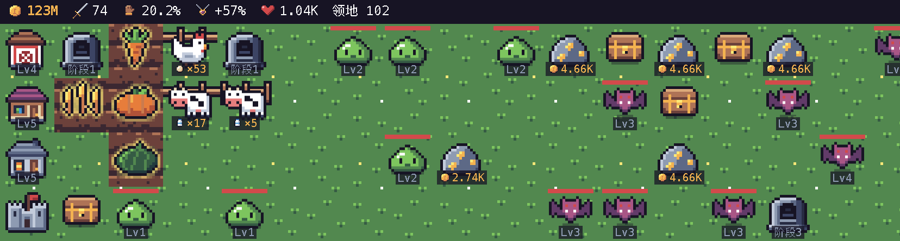
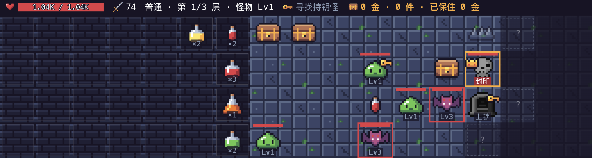

  

<h1 align="center">农场与地堡 · Farm & Dungeon</h1>

贴在桌面底部的像素风放置小游戏：开荒种田、养鸡养牛、打怪刷装备，再下地堡闯一闯。

  <a href="https://github.com/chichichiyuyu/farm-and-dungeon/releases/latest"><b>⬇ 下载最新版本</b></a>

  
  

## 下载安装

到 [Releases](https://github.com/chichichiyuyu/farm-and-dungeon/releases/latest) 下载：

- **macOS**：`maze-farm-<版本>-universal.dmg`，Intel 与 Apple 芯片通用。打开后把「农场与地堡」拖进「应用程序」。
- **Windows**：`maze-farm-<版本>-setup.exe`，双击即可安装。

安装包没有签名：macOS 首次打开请在「应用程序」里右键选择「打开」；Windows 出现 SmartScreen 提示时点「更多信息 → 仍要运行」。

存档保存在本机，升级安装不会丢失：

- macOS：`~/Library/Application Support/农场与地堡`
- Windows：`%APPDATA%\农场与地堡`

## 玩法

- **开垦领地**：从左下角的大本营出发，花金币一块块开垦迷雾里的土地。新土地可能藏着宝箱、怪物、金矿或地下城入口；岩石开垦更贵，但可能埋着金矿。
- **农场经营**：空地上建农田种小麦、胡萝卜、南瓜、西瓜，成熟后收获并自动补种；鸡舍、牛棚定时产出鸡蛋和牛奶；金矿每秒产金，可以升级。
- **打怪掉装备**：点击怪物攻击，打倒后有几率掉落装备。装备分 8 个部位、6 种稀有度，史诗及以上属于套装（集齐 3 件、5 件激活效果），还有连击、击晕、吸血、斩杀等特效。
- **城镇**：大本营上方依次是铁匠铺（买装备、锻造武器，最高 +12）、药剂铺（治疗与增益药水）和农场（解锁新作物和牲畜）；铁匠铺和药剂铺要等领地推进到一定列数才能开张和升级。
- **地下城**：从入口进入，共 3 层。每层先打倒持钥怪拿到钥匙，走下楼梯才算保住本层收获；最后一层拿到钥匙才能解除 Boss 的封印。撤退只带走已保住的部分，失败会丢掉背包并扣金币。通关后入口升阶（领地也要推进到相应列数），Boss 有几率掉落史诗门票，可以挑战更难的史诗模式。
- **挂机友好**：开启「自动」后每 3 秒自动收获作物、金矿和牲畜；金矿和牲畜离线也会累积（作物离线只长一季），金库升级可以提高存储上限。

## 桌面操作

游戏窗口固定在屏幕底部、始终置顶，在所有桌面空间都可见，不占用 Dock 和任务栏。

| 操作 | 效果 |
| --- | --- |
| 左键大本营 / 「收起」按钮 | 收起成屏幕左下角的一个小城堡，再点一下展开 |
| `⌘ + Shift + G`（Windows 为 `Ctrl + Shift + G`） | 全局老板键，随时收起 / 展开 |
| 右键大本营，或右键菜单栏 / 托盘里的城堡图标 | 游戏菜单：大本营升级、移到鼠标所在屏幕、切换语言、重置存档、退出 |
| 左键菜单栏 / 托盘里的城堡图标 | 收起 / 展开 |
| 按住大本营拖动 | 换到另一块屏幕，松手后自动贴底 |

界面支持简体中文和 English，默认跟随系统语言，可在右键菜单里切换。

## 关于

本仓库只用于发布安装包，源代码不公开。游戏可以免费下载和游玩，但未经许可请勿转载、二次分发或用于商业用途。

© 2026 jiangchiyu，保留所有权利。

---

English

**Farm & Dungeon** is a pixel-art idle game that lives at the bottom of your desktop. Reclaim land from the fog, grow crops, raise chickens and cows, mine gold, fight monsters for gear, then dive into a three-floor dungeon: defeat each floor's key-bearer to unlock the stairs and secure your loot, and break the boss's seal on the last floor.

The window stays on top and docks to the bottom of the screen. Click the castle or press `Cmd/Ctrl + Shift + G` to collapse it into a tiny castle, right-click for the game menu, and drag the castle to move it to another display. The UI follows your system language (Simplified Chinese or English).

Download the macOS `.dmg` or Windows `.exe` from [Releases](https://github.com/chichichiyuyu/farm-and-dungeon/releases/latest). The installers are unsigned: on macOS right-click the app and choose Open the first time; on Windows choose "More info → Run anyway".

This repository only hosts the installers; the source code is not public. Free to download and play. © 2026 jiangchiyu. All rights reserved.

